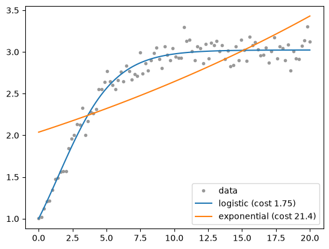

# PyBM - Pythonic process based modeling
Python reimplementation of [ProBMoT](http://probmot.ijs.si), which is  **easy to use** and works **magnitutes faster**.

## Installation
From the root of this repository, run 
```
pip install . 
```
## Example usage 
Asume that we want to model the growth of a population `pop`. Let $P(t)$ be the concentration (size) of the population at time $t$. Our model will estimate $r$ and choose the appropriate shape of the ODE for $P'(t)$ from:
- exponential growth: $P'(t) = rP(t)$ or
- logistical growth:  $P'(t) = rP(t)(1-\frac{P}{K})$,
where constants $r$ (growth rate) and $K$ (capacity) will be estimated from the data.

Following the philosophy of *process-based modeling (PBM)*, we will define 
- an *entity* `pop` (population) with variable `conc` ($P(t)$) and constant `r`
- two (sub)processes for exponential and logistical growth
- one (parent) `ChooseProcess`, which will tell the model to choose between exponential and logistical growth.
This will be passed into a `Model()` instance, which builds the list of all possible structures using `.induce()` 

```python
import numpy as np
from pybm.estimate.estimate import estimate_models_collocation
from pybm.model import ChooseProcess, Const, Context, Entity, Model, Ode, Process, Var
from pybm.simulate.trajectory import simulate
from scipy.integrate import solve_ivp
import matplotlib.pyplot as plt
# Build a model using PBM
# population with one variable and one constant
pop = Entity(Var("conc"), Const("rate", range=(0, 2)), name="pop")
# entity's variables and constants are accesible via pop[name]
P = pop["conc"]
r = pop["rate"]
# variables and constants can also be defined outside entities 
K = Const("capacity", range=(0, 10))
# a process is defined via Process(*equations)
# ODE equation v'=F is defined via ODE(v, F). 
exp_growth = Process(Ode(P, r * P))
# extra arguments, such as name can be added, but are not obligatory
#PyBM implicitly collects all the required objects. Inside low_growth, constant K is automatically added to the process and will be estimated, once the process is added to the model.
log_growth =  Process(Ode(P, r * P * (1 - P / K)), name="logistic")
# growth is described by either log or exp growth - the choice should be made based on the data. A parent proccess ChooseProcess denotes that:
growth  = ChooseProcess(log_growth, exp_growth)
# create a new model
# by passing growth into Model(), subprocess, entities, variables and constants will be inherited implicitly
model = Model(growth)

# create synthetic data, which follows the formula for logistic growth
# (rate 0.5, capacity 3) with 5 % noise.
t = np.linspace(0, 20, 100)
F = lambda _, P : 0.5 * P * (1 - P/3)
# P(t) is the solution of ODE P'=F. We assume initial condition P(0)=1
sol = solve_ivp(F, (t[0], t[-1]), np.array([1]) , t_eval=t)
data = sol.y[0] + np.random.normal(scale=0.1, size=(len(t),))

# attach the data to the model
model.vars["pop.conc"].set_data(t, data) 

# estimate models 
models = model.induce()

print(f"{len(models)} different structures were induced.")
# prefered preprepared function for estimation:
results = estimate_models_collocation(models, t)

# examine the results
def trajectory(result, t):
    """A free run of the fitted model: from the fitted initial state, with the fitted constants."""
    m = result.model
    x0 = np.zeros(len(m.get_endo_variables()))
    for name, value in zip(result.state_vars, result.x[0]):  # collocation's states at the first seed
        x0[m.vars[name].index_in_ctx] = value
    sol = simulate(m, t, Context(vars=x0, consts=result.consts), rtol=1e-8, atol=1e-10)
    return sol.y[m.vars["pop.conc"].index_in_ctx]


plt.plot(t, data, "o", color="0.6", ms=3, label="data")
# the candidates come in the order of the options of ChooseProcess
for name, result in zip(["logistic", "exponential"], results["all_results"]):
    print(f"{name}: cost {result.cost:.3g}, {result.const_by_name}")
    plt.plot(t, trajectory(result, t), label=f"{name} (cost {result.cost:.3g})")
plt.legend()
plt.show()
```
```
exponential: cost 5.22, {'pop.rate': 0.0732...}
logistic: cost 0.12, {'pop.rate': 0.510..., 'growth.capacity': 2.997...}
```

The logistic candidate fits far better, with constants close to the true ones.


More examples can be found in [tutorial.ipynb](tutorial.ipynb).

## Documentation
Coming soon 

## PyBM vs ProBMoT
## Process-based modeling
TODO
There is an elegant way to define PBM using type theory. 

